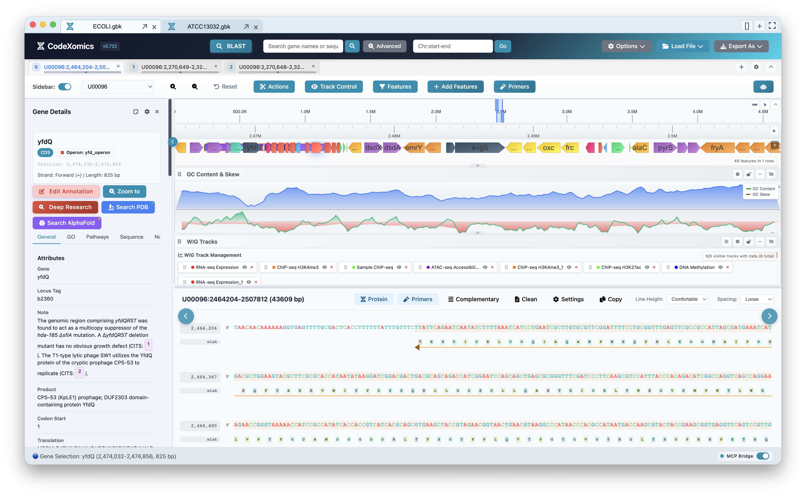
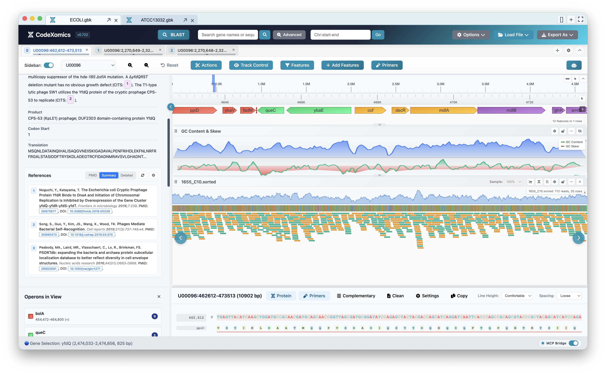
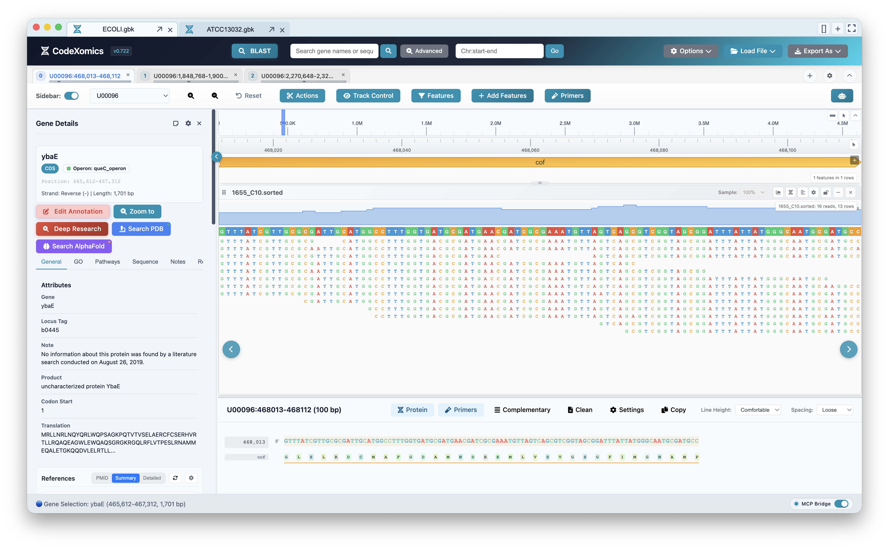
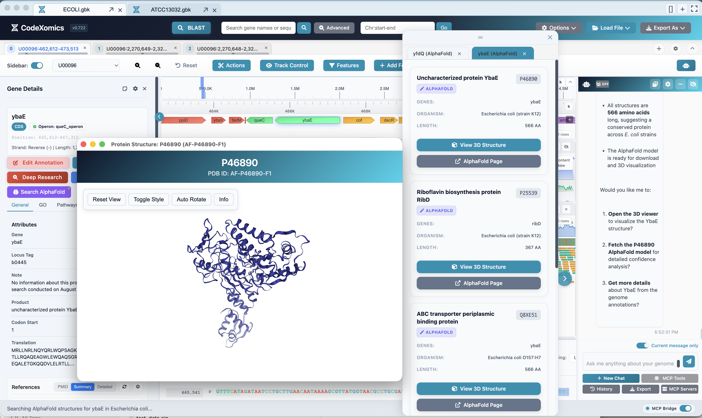
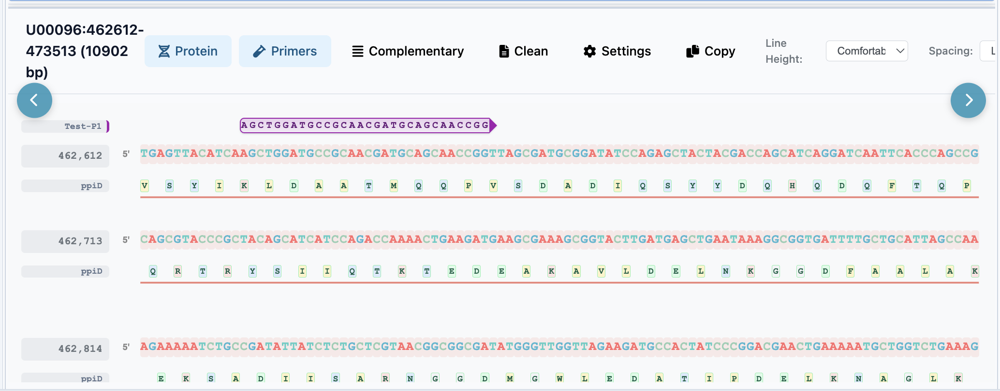

# CodeXomics

**The AI-native genome browser**

_Talk to your genome — AI agents drive the view and run the analysis._

[](https://github.com/Scilence2022/CodeXomics/releases)
[](https://github.com/Scilence2022/CodeXomics/blob/main/LICENSE)
[](https://github.com/Scilence2022/CodeXomics/releases)

[简体中文入口](zh/index.md) · [中文产品介绍页](landing/index-zh.html)

CodeXomics is an AI-native genome browser — a cross-platform Electron workspace where conversational AI agents drive the visualization and run real biological analyses, with plugin development, benchmark testing, and Model Context Protocol (MCP) integration.

This site documents the current source, version `0.723.0` (`v0.723` display). See [GitHub Releases](https://github.com/Scilence2022/CodeXomics/releases) for available installers and the [changelog](https://github.com/Scilence2022/CodeXomics/blob/main/CHANGELOG.md#unreleased) for changes since the release tag.

<div class="grid cards" markdown>

- :material-rocket-launch:{ .lg .middle } **Get Started**

  ***

  Install CodeXomics, configure an AI provider, and load your first genome.

  [:octicons-arrow-right-24: Getting Started](user-guides/GETTING_STARTED.md)

- :material-book-open-variant:{ .lg .middle } **User Guide**

  ***

  Learn the genome browser, ChatBox, plugins, BLAST, and benchmark workflows.

  [:octicons-arrow-right-24: User Guide](user-guides/USER_GUIDE.md)

- :material-lan-connect:{ .lg .middle } **MCP Server**

  ***

  Connect CodeXomics tools to MCP-compatible clients in tools or agent mode.

  [:octicons-arrow-right-24: MCP Server](user-guides/MCP_SERVER_GUIDE.md)

- :material-code-tags:{ .lg .middle } **Developer Guide**

  ***

  Understand the codebase, tool registry, agents, plugins, and tests.

  [:octicons-arrow-right-24: Developer Guide](developer-guides/DEVELOPER_GUIDE.md)

</div>

## Install And Start

For a source checkout, use Node.js 22.12 or newer in the 22.x line and npm 10 or newer.

```bash
git clone https://github.com/Scilence2022/CodeXomics.git
cd CodeXomics
npm install
npm start
```

Load a genome with **File → Load File → Genome File**. To use the ChatBox, open **Settings → Model Providers** (<kbd>⌘,</kbd> / <kbd>Ctrl+,</kbd>), save a provider, and select a default model. [Getting Started](user-guides/GETTING_STARTED.md)

### Genome Visualization

- Browse FASTA and GenBank genomes with annotations, variants, SAM/BAM alignments, and WIG/BigWig tracks. [Supported inputs](user-guides/GETTING_STARTED.md#load-data)
- Queue sequence edits and export a separate GenBank file. [Sequence editing](user-guides/USER_GUIDE.md#sequence-editing)

### AI-Assisted Analysis

- Ask the ChatBox to navigate, search, design primers, run BLAST, or simulate restriction digest and gel electrophoresis. [User Guide](user-guides/USER_GUIDE.md#ai-assistant)
- Track Deep Gene Research in the ChatBox and review evidence-backed annotation ChangeSets in the Review Center. [Deep Gene Research](user-guides/USER_GUIDE.md#deep-gene-research)
- Run automatic benchmarks in production-parity or oracle-assisted mode. [Benchmark Methods](reference/BENCHMARK_METHODS.md)

### Extensibility

- Build plugins with the VS Code-inspired extension host and Plugin API `2.0.0`.
- Expose plugin functions to AI tool calling.
- Serve and test marketplace plugins through `packages/marketplace-server/`.

### MCP Integration

- Start Electron with the authenticated MCP listener to give clients access to genome windows. Use tools mode for direct calls or agent mode to delegate natural-language prompts to the ChatBox. [MCP Server Guide](user-guides/MCP_SERVER_GUIDE.md)

## Screenshots

### Genome browser

Feature track, GC content and skew, multi-track WIG data, the gene details sidebar, and the protein/sequence view.



### Read alignment and references

Coverage and base-resolution sequencing-read tracks alongside gene references and operons in the side panel.



Base-level read pileup over a selected gene:



### Protein structures

AlphaFold structure lookup and an interactive 3D protein viewer, driven from the AI ChatBox.



### Primer design

Designed primers rendered directly on the sequence view.



## Documentation Map

| Section              | Start here                                                                                  |
| -------------------- | ------------------------------------------------------------------------------------------- |
| New users            | [Getting Started](user-guides/GETTING_STARTED.md)                                           |
| Daily usage          | [User Guide](user-guides/USER_GUIDE.md)                                                     |
| MCP clients          | [MCP Server Guide](user-guides/MCP_SERVER_GUIDE.md)                                         |
| Plugin users         | [Plugin Marketplace Guide](user-guides/PLUGIN_MARKETPLACE_GUIDE.md)                         |
| Developers           | [Developer Guide](developer-guides/DEVELOPER_GUIDE.md)                                      |
| AI coding assistants | [AI Assistant Guidelines](developer-guides/AI_ASSISTANT_GUIDELINES.md)                      |
| Architecture         | [Multi-Agent System](architecture/CodeXomics_Multi_Agent_System_Technical_Specification.md) |
| BLAST                | [BLAST Guide](reference/BLAST_GUIDE.md)                                                     |
| Benchmarks           | [Benchmark Methods](reference/BENCHMARK_METHODS.md)                                         |
| Current release      | [v0.723.0 Release Notes](release-notes/RELEASE_NOTES_v0.723.md)                             |

## Repository Links

- [GitHub Repository](https://github.com/Scilence2022/CodeXomics)
- [Issues](https://github.com/Scilence2022/CodeXomics/issues)
- [Discussions](https://github.com/Scilence2022/CodeXomics/discussions)
- [Releases](https://github.com/Scilence2022/CodeXomics/releases)
